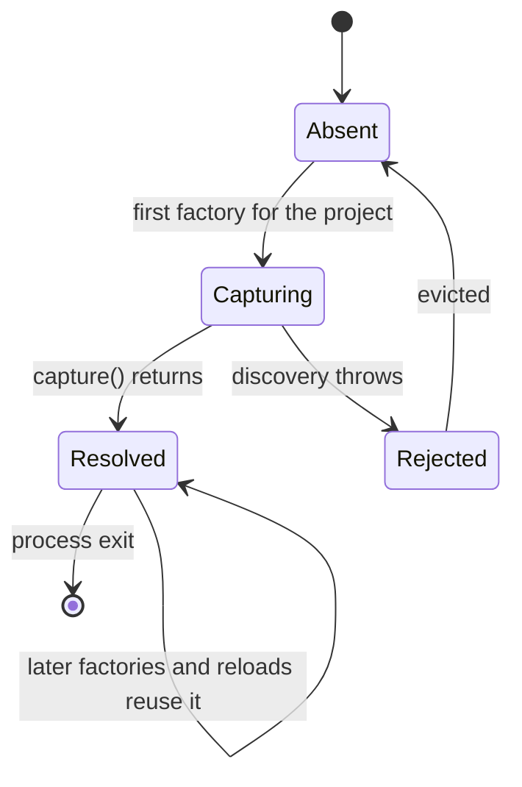
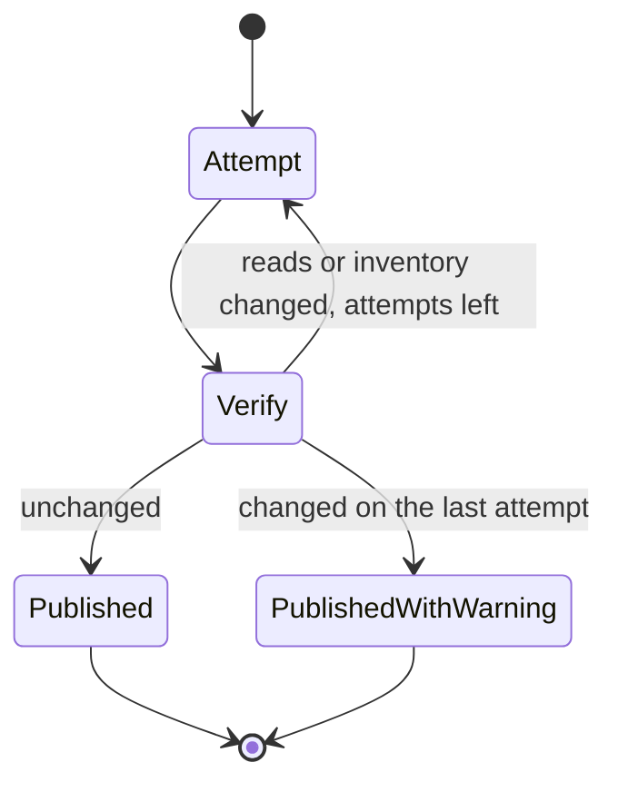
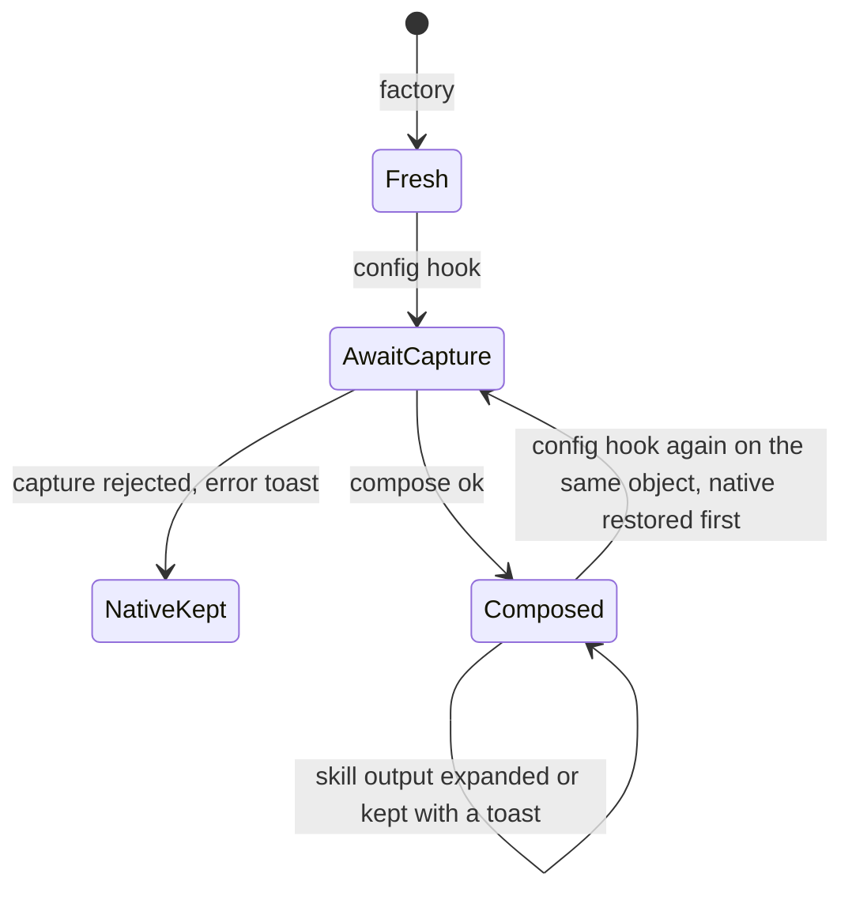
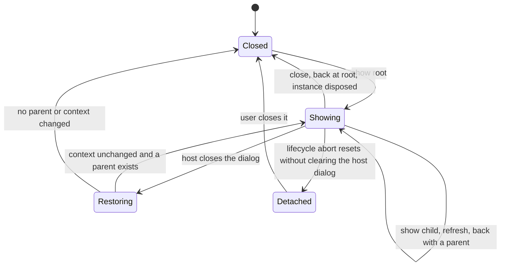
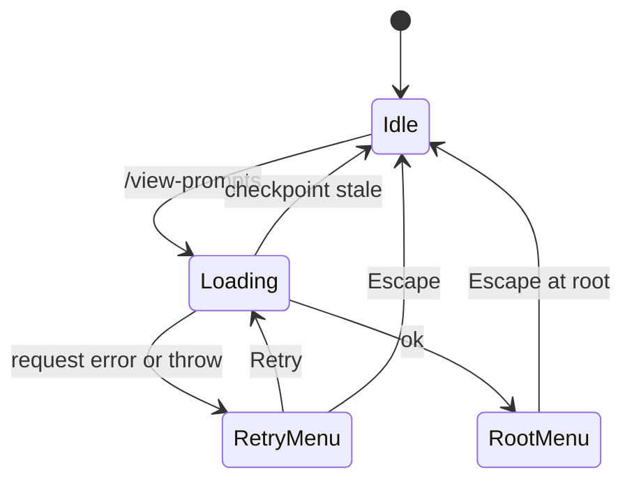

# State machines

This document describes the state Prompt Composer keeps across hooks, events and reloads. Update it in the same PR as any change to these states, their triggers or their exits, following the [state machine conventions](https://github.com/lunchbox-labs/.github/blob/main/agent-guidance/state-machines.md). Known bugs belong in issues, not here.

OpenCode reruns the server plugin's factory on every instance load but keeps the imported module, so module-level state lasts for the process and closure state is rebuilt on each reload.

## Snippet capture cache

`snapshots` in `src/startup-snippets.ts` maps each resolved directory and worktree pair to the promise of its capture. `startupSnippets` returns the existing promise for a key, so every factory for the same project shares one capture until OpenCode restarts.

- The first factory for a key starts `capture()`.
- A capture that resolves, with or without warnings, is kept for the rest of the process.
- A capture that rejects, which in practice means `discoveryDirectories` failed (the ancestor limit, or an unexpected `lstat` error on a `.opencode` directory), is evicted so a later factory captures again. The factory that started it keeps its rejected promise.

## Capture attempts

`capture()` makes up to `CAPTURE_ATTEMPTS` (3) attempts. Each one discovers files leniently, reads each file into a source or an error, then re-reads the successful reads and the inventory to confirm nothing changed. A change starts another attempt; on the last attempt the latest reads are kept with a warning to restart OpenCode once edits settle. Failed reads are kept as they are. The result is frozen inside the `expand` closure, and an error entry is thrown again each time an include uses it.

## Server plugin instance

Each factory run in `src/server.ts` holds:

- `startup`: the shared capture promise for this project.
- `firstConfig`: true until the first config hook, so option and capture warnings are toasted once per instance.
- `snapshots`: a `WeakMap` from a config object to its native and applied bodies, so a second config hook on the same object restores the native bodies before composing again.

The config hook awaits `startup`. If it rejected, the hook shows an error toast and leaves the config unchanged. Otherwise it composes, shows any warnings, writes `config.agent` and `config.command` and records the snapshot. `tool.execute.after` for the skill tool expands includes in skill output from the same frozen capture, or returns the native output with a toast.

## Composition and expansion

These have no state that outlives one call:

- Composition (`src/runtime.ts`) gives each agent or command one outcome: composed, composed with warnings, native kept (an empty result with problems, or `expand` threw, for example at the size limit), or skipped (disabled, blank or not a string).
- Include expansion (`src/include-core.ts`) tracks an include count, `limitReported` and the recursion stack for cycle checks. An escaped marker is written literally, a malformed one is left as written with a warning, a failing one expands to nothing with a warning, and exceeding `promptSize` throws an `IncludeError` that the caller turns into a fallback.
- The skill output gate (`src/skill-body.ts`) is a chain of checks. Every exit except a successful expansion returns the native output, with a toast unless nothing needed doing.
- Discovery (`src/discovery.ts`) counts entries and, in lenient mode, leaves out entries that fail with `leaveOut`. `EntryLimitError` stops the walk and becomes one warning.

## TUI dialog navigation

`src/navigation.ts` keeps `frames`, `revision`, `replacing` and `visible`.

- `show` pushes a frame (a root frame resets first) and displays it. Displaying increments `revision` and replaces the host dialog with `replacing` set, so the host's close callback for the previous dialog is ignored.
- When the host closes the current dialog (Escape, OK or Cancel), the top frame is popped and a microtask redisplays the parent, unless the route, client, directory or lifecycle changed or another dialog is open, in which case navigation resets.
- Back pops and redisplays the parent, or closes with fewer than two frames. `refresh` redisplays the top frame and `close` resets and clears the dialog.
- `checkpoint` captures the revision, client, path and route; picker callbacks check it so callbacks from a retired dialog do nothing.

## /view-prompts load

`src/tui.ts` shows a "Loading prompts" alert and takes a checkpoint. A stale checkpoint (the alert was dismissed, the viewer reopened, or the route, client or directory changed) ends silently. A failed request or a throw shows a retry menu whose Retry loads again. Success shows the root menu, and navigation takes over.

## Persisted and lifecycle state

- The `prompt-composer.showBuiltins` kv value is read once per open; toggling it writes kv and refreshes. Before kv is ready it reads as false.
- The fixed menu and text viewer renderables go from created to focused on a 1 ms timer, and clear their timer, resize listener, keymap layer and abort listener when destroyed by the host or a lifecycle abort.
- The TUI plugin registers the `/view-prompts` command and a `server.instance.disposed` watcher that closes an open viewer for the same directory, and unregisters both on dispose.
